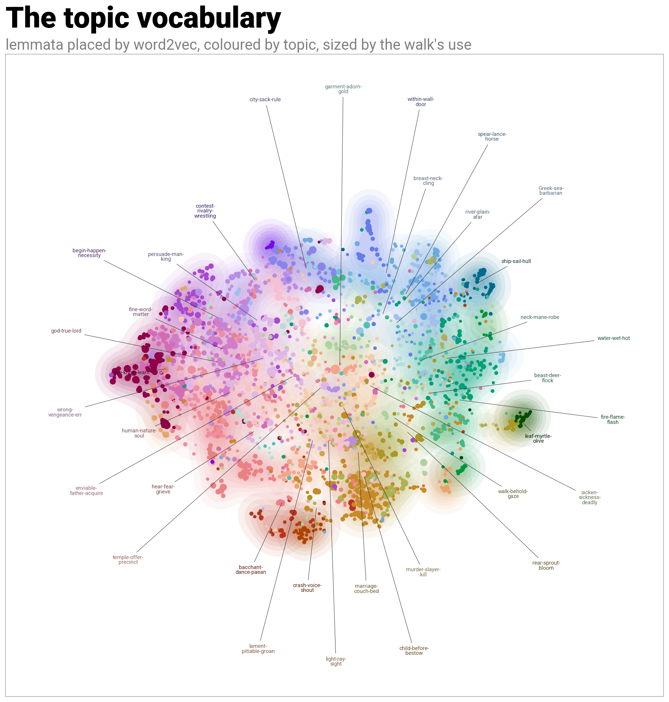
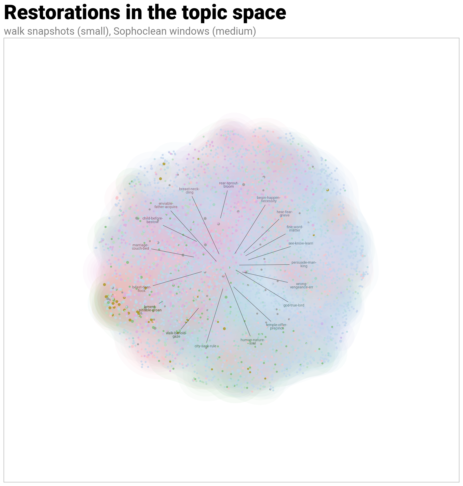
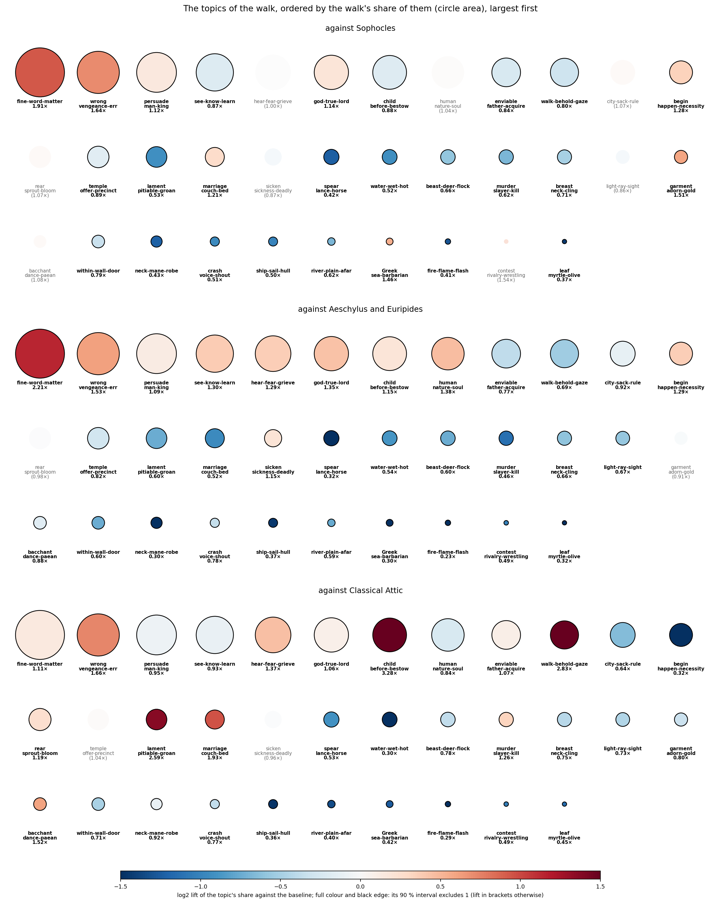
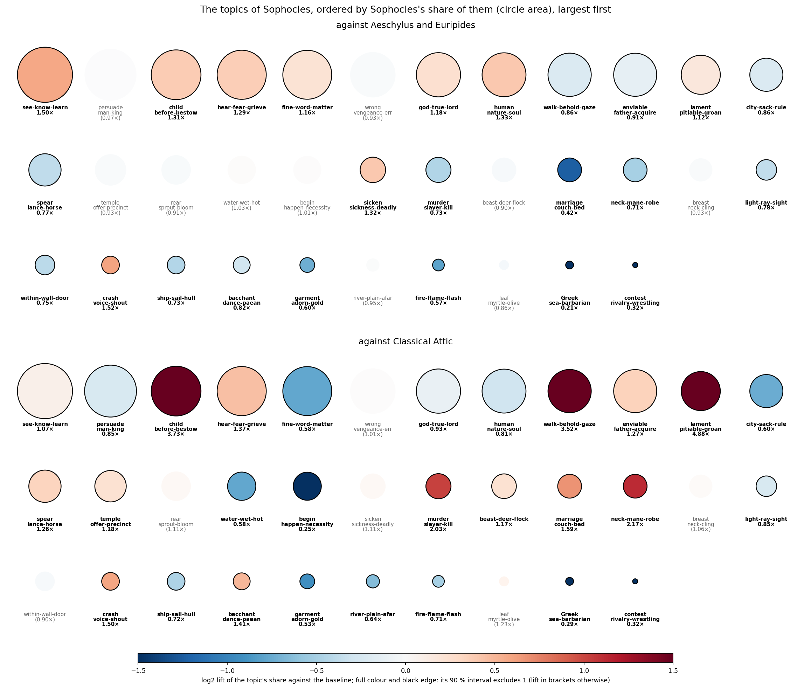
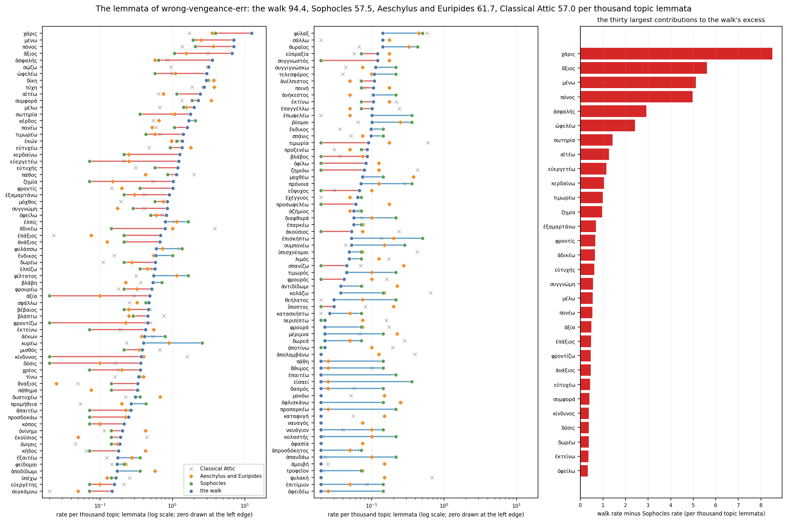
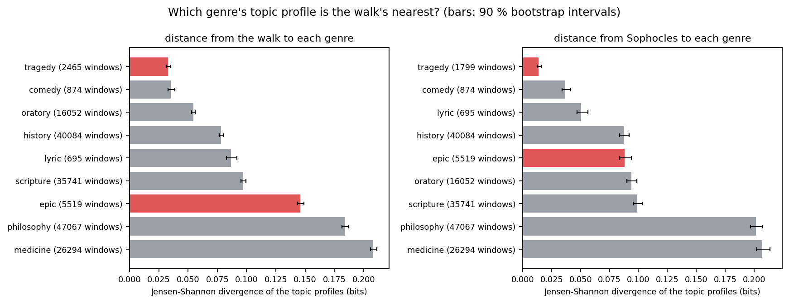

```{r setup, include = FALSE}
knitr::opts_chunk$set(message = FALSE, warning = FALSE, fig.width = 7)
# on a headless Linux box ragg draws the PNGs without an X11 display
if (requireNamespace("ragg", quietly = TRUE)) {
  knitr::opts_chunk$set(dev = "ragg_png")
}
library(arrow)      # reads the parquet files
library(dplyr)      # filter(), arrange(), bind_rows()
library(jsonlite)   # reads vocab.json
library(ggplot2)
set.seed(params$seed)
```

# The question

P.Oxy. 5292 preserves twelve intact trimeters of Sophocles' *Tereus* and
seventeen damaged ones (vv. 13–29). The judge-steered Markov walk restores
the seventeen verses together, as one passage. Which topics does the walk
put into the lost passage, and does that differ from what Sophocles writes
elsewhere? (W. B. Henry's restoration of the same verses is in the data,
but a single text is not compared with the mean of thousands: it is left
out.)

# The model

Every lemma of the vocabulary belongs to exactly one of $K$ semantic clusters
(word2vec on the lemmatised Greek corpus, Ward's method, cut at $K = 40$; two
rare-lemma clusters and four function-word clusters dropped, leaving 34).
Each cluster is named by the English glosses of the three lemmata nearest
its centre, for example *fine-word-matter* or *ship-sail-hull*. A
**document** is one whole restoration of the seventeen verses: all its
topic-bearing lemmata, however many there are, with nothing
cut off. Its topic counts are

$$\mathbf n \mid \theta \sim \mathrm{Multinomial}(N, \theta), \qquad
  \theta \sim \mathrm{Dirichlet}(\kappa \mathbf m),$$

where $N$ is the document's own length, $\mathbf m$ is the topic profile of
Sophocles' extant trimeters and $\kappa = 1$ is one pseudo-lemma's worth of
it. The prior says that a restoration is, a priori, Sophoclean, and it is
weak: with $\kappa = 1$ a document of twenty lemmata is 95 % data. A
symmetric prior would not do here, because documents differ in length and
a symmetric prior pulls short documents harder towards the uniform
profile, which fabricates lift for topics that are simply absent. The
Dirichlet is conjugate to the multinomial, so the posterior is exact,

$$\theta \mid \mathbf n \sim \mathrm{Dirichlet}(\kappa \mathbf m + \mathbf n),$$

and needs no sampler beyond `rgamma`. A **cell** is a set of restorations
of the passage. Two posteriors are read from it. The posterior of a
**random document** of the cell is the equal mixture of its documents'
posteriors: its spread is the spread between restorations plus the
Dirichlet uncertainty of each. The posterior of the cell's **mean profile**
is the average of the documents' posteriors, draw by draw: it says what the
cell puts into the passage on average, and with thousands of restorations
it is sharp. The cells are

- **walk**: every untilted snapshot of the walk, one document each;
- **sophocles**, the baseline: every window of seventeen consecutive extant
  trimeters of Sophocles, one document each, the same shape as the lacuna.

A cell is compared with the baseline on both levels:
$P(\bar\theta_k^{\text{cell}} > \bar\theta_k^{\text{Soph}})$ for the mean
profiles over paired draws, with the lift of the means, and
$P(\theta_k^{\text{doc}} > \theta_k^{\text{window}})$ for a random document
against a random window of Sophocles, which measures how much the two
populations overlap. A topic counts as **raised** when the mean-profile
probability is at least 0.9 and the lift at least 1.5. Only the restored
text enters a document:
the surviving letters of a damaged verse are never counted.

# Data

The dataset `Urdatorn/bsda-miniproject-2026` on the Hugging Face Hub: one bag
of content lemmata per restored verse, the vocabulary with its cluster labels,
and the corpus of the three tragedians. The chunk below downloads the three
files (20 MB) into `data/` the first time the report is knitted.

```{r download}
hub <- "https://huggingface.co/datasets/Urdatorn/bsda-miniproject-2026"
dir.create(params$data, showWarnings = FALSE, recursive = TRUE)
for (file_name in c("vocab.json", "corpus.parquet", "imputations.parquet")) {
  local_path <- file.path(params$data, file_name)
  if (!file.exists(local_path)) {
    url <- paste(hub, "resolve/main", file_name, sep = "/")
    download.file(url, local_path, mode = "wb", quiet = TRUE)
  }
}
```

```{r data}
vocab <- fromJSON(file.path(params$data, "vocab.json"))
corpus <- read_parquet(file.path(params$data, "corpus.parquet"))
imputations <- read_parquet(file.path(params$data, "imputations.parquet"))

# Every row of corpus and imputations is one bag of lemmata: the lemma
# indices (lemma_idx, counted from 0) and how often each occurs (count).
# This function turns a table of bags into one long vector of lemma indices,
# repeating each index as often as it was counted.
lemma_stream <- function(table) {
  indices <- unlist(table$lemma_idx)
  counts <- unlist(table$count)
  rep(indices, counts)
}

# A lemma index becomes the label of its topic. Lemmata without a topic (NA)
# are dropped: they are not observations of any topic.
topic_stream <- function(lemma_indices) {
  labels <- vocab$cluster_K40[lemma_indices + 1]   # R counts from 1
  labels[!is.na(labels)]
}

# The topics, ordered by how much of the tragic corpus they cover
tragedians <- c("sophocles", "aeschylus", "euripides")
tragic <- filter(corpus, source %in% tragedians)
tragic_topics <- topic_stream(lemma_stream(tragic))
topic_mass <- sort(table(tragic_topics), decreasing = TRUE)
topic_names <- names(topic_mass)
K <- length(topic_names)

cat(K, "topics;", nrow(vocab), "lemmata in the vocabulary,",
    sum(!is.na(vocab$cluster_K40)), "with a topic;",
    nrow(imputations), "restored verses\n")
```

# The topics

The 34 topics are hard clusters of the vocabulary, built upstream (word2vec
on the lemmatised Greek corpus, Ward's method, cut at $K = 40$, six clusters
dropped) and delivered with the vocabulary as `cluster_K40`; the Greek
triple behind each English label is the three lemmata nearest the cluster's
centre. The table orders them by their share of the three tragedians'
trimeters; the LaTeX version for the paper is `latex/topics_table.tex`.

```{r topics_table}
with_topic <- filter(vocab, !is.na(cluster_K40))
topics_table <- data.frame(topic = topic_names,
                           lemmata_greek = NA, lemmata = NA, tragic_tokens = NA)
for (i in seq_len(K)) {
  members <- filter(with_topic, cluster_K40 == topic_names[i])
  topics_table$lemmata_greek[i] <- members$cluster_K40_lemmata[1]
  topics_table$lemmata[i] <- nrow(members)
  topics_table$tragic_tokens[i] <- sum(members$tragic_count)
}
knitr::kable(topics_table, row.names = FALSE,
             col.names = c("topic", "its three central lemmata", "lemmata",
                           "tragic tokens"))
```

The vocabulary on the map it was clustered in: every topic-bearing lemma
placed by UMAP from its word2vec vector and coloured by its topic, a
point's size the walk's use of the word, a label's size the walk's share of
the topic (`scripts/lemma_map.py`; the interactive version with hover and
search is `figures/hard_lemma_map.html`).

```{r lemma_map, echo = FALSE, out.width = "100%"}

```

And the documents themselves: every walk snapshot and every Sophoclean
window placed by UMAP from its profile over the 34 topics (Hellinger
distance), coloured by its dominant topic (`scripts/topic_map.py`,
interactive `figures/hard_topic_map.html`). Documents of a few dozen
lemmata are mixtures, so the map has no clean regions; it is for browsing
the restorations, not evidence.

```{r topic_map, echo = FALSE, out.width = "100%"}

```

# The posterior

```{r model}
kappa <- params$kappa
draws <- params$draws

# One line per topic-bearing lemma of a table of bags, with the document
# (group) the lemma belongs to. `group` names the document of every row.
lemma_table <- function(table, group) {
  row_of_entry <- rep(seq_len(nrow(table)), lengths(table$lemma_idx))
  row_of_lemma <- rep(row_of_entry, unlist(table$count))
  lemmata <- data.frame(group = group[row_of_lemma],
                        topic = vocab$cluster_K40[lemma_stream(table) + 1])
  filter(lemmata, !is.na(topic))
}

# The documents of a table: the topic labels of every group, as a list.
# A group without any topic-bearing lemma gives no document.
make_documents <- function(table, group) {
  lemmata <- lemma_table(table, group)
  split(lemmata$topic, lemmata$group)
}

# S draws from a Dirichlet distribution: gamma variables, normalised to sum 1
rdirichlet <- function(S, parameters) {
  gammas <- matrix(rgamma(S * length(parameters), shape = parameters),
                   nrow = S, byrow = TRUE)
  gammas / rowSums(gammas)
}

# The prior: Sophocles' topic profile, worth kappa lemmata
sophocles_topics <- topic_stream(lemma_stream(filter(corpus,
                                                     source == "sophocles")))
prior_mean <- tabulate(match(sophocles_topics, topic_names), nbins = K)
prior_mean <- prior_mean / sum(prior_mean)
prior <- kappa * prior_mean

# The exact posterior of one document: count its labels per topic, add the
# prior, and draw from Dirichlet(prior + counts).
posterior_draws <- function(document) {
  counts <- tabulate(match(document, topic_names), nbins = K)
  rdirichlet(draws, prior + counts)
}

# A cell's two posteriors. `document_draws` stacks the draws of all its
# documents: a random document of the cell. `mean_draws` averages the
# documents' draws, one average per draw index: the cell's mean profile.
# If a baseline (Sophocles) is given, the cell is compared with it on both
# levels, draw by draw.
summarise_cell <- function(documents, baseline = NULL) {
  n_docs <- length(documents)
  document_draws <- matrix(0, nrow = draws * n_docs, ncol = K)
  for (i in seq_len(n_docs)) {
    first <- (i - 1) * draws + 1
    last <- i * draws
    document_draws[first:last, ] <- posterior_draws(documents[[i]])
  }
  draw_index <- rep(seq_len(draws), times = n_docs)
  mean_draws <- rowsum(document_draws, draw_index) / n_docs
  result <- list(n_docs = n_docs,
                 n_lemmata = mean(lengths(documents)),
                 mean = colMeans(mean_draws),
                 q05 = apply(mean_draws, 2, quantile, probs = 0.05),
                 q95 = apply(mean_draws, 2, quantile, probs = 0.95),
                 document_draws = document_draws,
                 mean_draws = mean_draws)
  if (!is.null(baseline)) {
    result$p_above <- colMeans(mean_draws > baseline$mean_draws)
    result$lift <- colMeans(mean_draws) / colMeans(baseline$mean_draws)
    pick <- sample(nrow(baseline$document_draws), nrow(document_draws),
                   replace = TRUE)
    paired <- baseline$document_draws[pick, ]
    result$p_document <- colMeans(document_draws > paired)
  }
  result
}
```

The cells, and the model's table: one row per cell and topic.

```{r cells}
# Sophocles' extant trimeters in windows of seventeen, the baseline
sophocles <- filter(corpus, source == "sophocles")
sophocles <- arrange(sophocles, line)
window <- (seq_len(nrow(sophocles)) - 1) %/% 17
sophocles_documents <- make_documents(sophocles, window)
baseline <- summarise_cell(sophocles_documents)

# Only untilted snapshots are used (the tilt flag is empty, NA, for the
# restorers that were never tilted)
untilted <- filter(imputations, !coalesce(style_tilted, FALSE))

# The walk: one document per snapshot (one chain at one step, all seventeen
# verses). Chains run alone have an empty chain number, so there the chain
# set is the chain.
walk <- filter(untilted, restorer == "walk")
walk$chain_id <- ifelse(is.na(walk$chain), walk$chain_set,
                        paste(walk$chain_set, walk$chain))
walk$snapshot <- paste(walk$chain_id, walk$iteration)
walk_documents <- make_documents(walk, walk$snapshot)

cells <- list()
cells[["walk"]] <- summarise_cell(walk_documents, baseline)

# One row per cell and topic, the model's table
rows <- NULL
for (cell_name in names(cells)) {
  cell <- cells[[cell_name]]
  cell_rows <- data.frame(cell = cell_name,
                          topic = topic_names,
                          n_docs = cell$n_docs,
                          n_lemmata = cell$n_lemmata,
                          mean = cell$mean,
                          q05 = cell$q05,
                          q95 = cell$q95,
                          p_above_sophocles = cell$p_above,
                          lift = cell$lift,
                          p_document = cell$p_document)
  rows <- rbind(rows, cell_rows)
}
rows$raised <- rows$p_above_sophocles >= 0.9 & rows$lift >= 1.5
for (column in c("n_lemmata", "mean", "q05", "q95", "p_above_sophocles",
                 "lift", "p_document")) {
  rows[[column]] <- round(rows[[column]], 4)
}

sizes <- data.frame(cell = c("sophocles", names(cells)),
                    documents = c(baseline$n_docs,
                                  sapply(cells, function(c) c$n_docs)),
                    lemmata_per_document = c(baseline$n_lemmata,
                                             sapply(cells,
                                                    function(c) c$n_lemmata)))
knitr::kable(sizes, digits = 1, row.names = FALSE,
             caption = "The cells: documents and topic-bearing lemmata each")
```

# Sophocles' baseline

```{r baseline, fig.height = 5}
baseline_table <- data.frame(topic = factor(topic_names, rev(topic_names)),
                             mean = baseline$mean)
ggplot(baseline_table, aes(x = topic, y = mean)) +
  geom_col() +
  coord_flip() +
  labs(x = NULL, y = "posterior mean of theta",
       title = paste("Sophocles,", baseline$n_docs,
                     "windows of seventeen trimeters")) +
  theme_minimal(9)
```

# Topics raised above Sophocles

Topics whose mean profile is above Sophocles' with
$P \ge 0.9$ and a lift of at least 1.5, with the lift, the posterior mean
and, in brackets, the document-level probability
$P(\theta_k^{\text{doc}} > \theta_k^{\text{window}})$.

```{r raised, results = "asis"}
raised <- filter(rows, raised)
raised <- arrange(raised, cell, desc(lift))
for (cell_name in names(cells)) {
  cell_raised <- filter(raised, cell == cell_name)
  if (nrow(cell_raised) == 0) {
    cat("- **", cell_name, "**: none\n", sep = "")
    next
  }
  items <- sprintf("%s (%.1f×, %.2f [%.2f])", cell_raised$topic,
                   cell_raised$lift, cell_raised$mean,
                   cell_raised$p_document)
  cat("- **", cell_name, "** (", cell_raised$n_docs[1], " documents): ",
      paste(items, collapse = ", "), "\n", sep = "")
}
```

# Lift of every topic in every cell

```{r lifts, fig.height = 7}
lifts <- rows
lifts$cell <- factor(lifts$cell, levels = names(cells))
lifts$topic <- factor(lifts$topic, levels = rev(topic_names))
ggplot(lifts, aes(x = topic, y = lift, fill = raised)) +
  geom_col() +
  geom_hline(yintercept = 1, linetype = "dashed") +
  coord_flip() +
  facet_wrap(~ cell, ncol = 2) +
  scale_fill_manual(values = c("grey70", "firebrick"),
                    name = "raised: P >= 0.9\nand lift >= 1.5") +
  labs(x = NULL, y = "lift of the posterior mean against Sophocles") +
  theme_minimal(8) +
  theme(legend.position = "bottom")
```

# The largest lifts

The five topics with the largest lift in every cell.

```{r top}
top_five <- NULL
for (cell_name in names(cells)) {
  cell_rows <- arrange(filter(rows, cell == cell_name), desc(lift))
  top_five <- rbind(top_five, head(cell_rows, 5))
}
top_five <- top_five[, c("cell", "topic", "mean", "q05", "q95",
                         "p_above_sophocles", "lift", "p_document")]
knitr::kable(top_five, digits = 2, row.names = FALSE)
```

# Beyond Sophocles: three baselines

Is the walk's profile unusual, and against whom? Two further baselines are
cut from other text into windows of 28 vocabulary lemmata, the length of
the walk's mean document: Aeschylus and Euripides, and Classical Attic,
the works of the Attic authors before Alexander in the Open Greek and Latin
texts parsed by the same tagger (the tragedians with their lyrics,
Aristophanes, Thucydides, Xenophon, Plato, Aristotle, the Attic orators and
the sophists who wrote Attic, 28,882 windows). Sophocles is cut the same
way. The shares here are plain rates per thousand topic lemmata, pooled
over a cell's documents; a lift's 90 % interval comes from resampling the
walk by chain and a baseline by window. The figures are drawn by
`scripts/topic_circles.py`, `scripts/topic_lemmata.py` and
`scripts/genre_distance.py` from `data/baseline_windows.parquet`
(`scripts/window_baselines.py`); their tables are in `results/hard/`.

One circle per topic, ordered by the walk's share of it (the area), coloured
by the log2 lift against each baseline, in full colour with the lift printed
where the interval excludes 1:

```{r circles_walk, echo = FALSE, out.width = "100%"}

```

The same with Sophocles as the focus, against the other two tragedians and
against Classical Attic, so that his own topics are visible beside the
walk's:

```{r circles_sophocles, echo = FALSE, out.width = "100%"}

```

```{r baselines_table}
circles <- read.csv("results/hard/topic_circles.csv", encoding = "UTF-8")
circles$off_one <- circles$lift_q05 > 1 | circles$lift_q95 < 1
# For every comparison: how many topics have an interval off 1, and the
# three largest and three smallest lifts among them
baseline_rows <- NULL
for (comparison in unique(circles$comparison)) {
  these <- filter(circles, comparison == !!comparison, off_one)
  these <- arrange(these, desc(lift))
  largest <- paste(sprintf("%s %.2f", head(these$topic, 3),
                           head(these$lift, 3)), collapse = ", ")
  smallest <- paste(sprintf("%s %.2f", tail(these$topic, 3),
                            tail(these$lift, 3)), collapse = ", ")
  baseline_rows <- rbind(baseline_rows,
                         data.frame(comparison = comparison,
                                    off_one = nrow(these),
                                    largest = largest, smallest = smallest))
}
knitr::kable(baseline_rows, row.names = FALSE,
             col.names = c("comparison", "topics off 1", "largest lifts",
                           "smallest lifts"))
```

The one lift of the walk that holds against every baseline is
*wrong-vengeance-err*:

```{r wrong_vengeance}
one_topic <- filter(circles, topic == "wrong-vengeance-err")
one_topic <- one_topic[, c("comparison", "lift", "lift_q05", "lift_q95",
                           "p_document")]
knitr::kable(one_topic, digits = 3, row.names = FALSE)
```

Opened up lemma by lemma, the lift is not vengeance: the walk's excess over
Sophocles is carried by χάρις, ἄξιος, μένω, πόνος, ἀσφαλής and ὠφελέω, the
vocabulary of favour, worth, toil and safety, while the cluster's words of
punishment are flat or down.

```{r lemmata, echo = FALSE, out.width = "100%"}

```

```{r excess}
lemmata <- read.csv("results/hard/topic_lemmata_wrong-vengeance-err.csv",
                    encoding = "UTF-8")
lemmata <- arrange(lemmata, desc(excess_over_sophocles))
top_lemmata <- head(lemmata, 12)
top_lemmata <- top_lemmata[, c("lemma", "rate_walk", "rate_sophocles",
                               "rate_tragedians", "rate_attic",
                               "excess_over_sophocles")]
caption <- paste("Rates per thousand topic lemmata: the twelve lemmata",
                 "with the largest excess over Sophocles")
knitr::kable(top_lemmata, digits = 2, row.names = FALSE, caption = caption)
```

Finally, does the walk write tragedy or its generator's Greek at large? The
Jensen–Shannon divergence from the walk's topic profile to nine genres of
authors of every period, with the same bootstraps; Sophocles beside it as
the profile of a text that is tragedy:

```{r genres, echo = FALSE, out.width = "100%"}

```

```{r genre_table}
genres <- read.csv("results/hard/genre_distance.csv", encoding = "UTF-8")
genres <- genres[, c("focus", "genre", "windows", "js_bits", "js_q05",
                     "js_q95")]
knitr::kable(genres, digits = 4, row.names = FALSE)
genre_topics <- read.csv("results/hard/genre_topics.csv", encoding = "UTF-8")
closer <- table(genre_topics$closer_to)
cat("Topic by topic, the walk's rate is closer to tragedy's for",
    closer[["tragedy"]], "topics and to epic's for", closer[["epic"]], "\n")
```

# Checks of the walk's profile

Three checks that belong to the hard model's counts and are therefore in
this report only: how variable the topics are from document to document,
whether the walk's lifts drift along the walk, and whether the chains agree.

## How variable are the topics?

How much does a topic's share move from one document to the next, and does
that variability itself differ between topics? For every topic, the share
of a document's lemmata it takes is computed in every document, and its
standard deviation across documents is compared with the standard deviation
a multinomial of the same mean share and the cell's mean length would
produce by sampling alone, $\sqrt{p(1-p)/N}$. Their ratio is the excess
variability: 1 means a topic varies no more than coin-tossing would, 2
means its real spread is twice that. The spread of these numbers across
topics is the "variance of the variances".

```{r variability}
# The share of every topic in every document, as a matrix
share_table <- function(documents) {
  shares <- matrix(0, nrow = length(documents), ncol = K)
  for (i in seq_along(documents)) {
    counts <- tabulate(match(documents[[i]], topic_names), nbins = K)
    shares[i, ] <- counts / length(documents[[i]])
  }
  shares
}

# Per topic: the mean share, its standard deviation across documents, the
# standard deviation sampling alone would give, and their ratio
topic_variability <- function(documents, label) {
  shares <- share_table(documents)
  mean_length <- mean(lengths(documents))
  share_mean <- colMeans(shares)
  share_sd <- apply(shares, 2, sd)
  sampling_sd <- sqrt(share_mean * (1 - share_mean) / mean_length)
  data.frame(cell = label, topic = topic_names, mean = share_mean,
             sd = share_sd, sampling_sd = sampling_sd,
             excess = share_sd / sampling_sd)
}
variability <- rbind(topic_variability(sophocles_documents, "sophocles"),
                     topic_variability(walk_documents, "walk"))
for (column in c("mean", "sd", "sampling_sd", "excess")) {
  variability[[column]] <- round(variability[[column]], 4)
}

# One row per topic: Sophocles and the walk side by side
sophocles_var <- filter(variability, cell == "sophocles")
walk_var <- filter(variability, cell == "walk")
side_by_side <- data.frame(topic = topic_names,
                           sophocles_mean = sophocles_var$mean,
                           sophocles_sd = sophocles_var$sd,
                           sophocles_excess = sophocles_var$excess,
                           walk_mean = walk_var$mean,
                           walk_sd = walk_var$sd,
                           walk_excess = walk_var$excess)
side_by_side <- arrange(side_by_side, desc(sophocles_excess))
knitr::kable(side_by_side, digits = 3, row.names = FALSE)
```

```{r variability_summary, results = "asis"}
# The spread of the variability across topics, for each cell
for (cell_name in c("sophocles", "walk")) {
  cell_var <- filter(variability, cell == cell_name)
  cat(sprintf(paste("- **%s**: the between-document sd of a topic's share",
                    "ranges from %.3f to %.3f (median %.3f); its coefficient",
                    "of variation across topics is %.2f. The excess over",
                    "sampling ranges from %.2f to %.2f (median %.2f).\n"),
              cell_name, min(cell_var$sd), max(cell_var$sd),
              median(cell_var$sd), sd(cell_var$sd) / mean(cell_var$sd),
              min(cell_var$excess), max(cell_var$excess),
              median(cell_var$excess)))
}
```

```{r variability_plot, fig.height = 4}
ggplot(variability, aes(x = mean, y = sd, colour = cell)) +
  geom_point() +
  geom_line(aes(y = sampling_sd), linetype = "dashed") +
  labs(x = "mean share of the topic", y = "sd of the share across documents",
       title = "Topic variability against its mean; dashed: sampling alone",
       colour = NULL) +
  theme_minimal(9)
```

## Where the walk went

A reviewer may object that the walk's topics only reflect the region of the
restoration space that the chains happened to visit. Two checks answer that.
First, does the lift of a topic drift as the walk proceeds? The snapshots are
grouped into windows of steps, every window is a cell, and the slope of its
lift against the step is the rate of change. Second, do the 48 chains
agree? Each chain's snapshots form a series of topic shares, and the
Gelman–Rubin $\hat R$ (BDA3 §11.4) compares the spread between chains with the
spread within them: $\hat R$ near 1 means a chain's share does not depend on
which chain it is.

```{r walk_lemmata}
# One line per topic-bearing lemma of the walk, with its snapshot, chain
# and step
walk_lemmata <- lemma_table(walk, walk$snapshot)
names(walk_lemmata)[names(walk_lemmata) == "group"] <- "snapshot"
walk_row <- match(walk_lemmata$snapshot, walk$snapshot)
walk_lemmata$chain_id <- walk$chain_id[walk_row]
walk_lemmata$step <- walk$iteration[walk_row]
```

## Drift over the steps

```{r drift}
# The lift of every topic in each window of steps: the window's snapshots
# are its documents, compared with Sophocles exactly as the walk cell is
lift_in_windows <- function(lemmata, breaks) {
  windows <- NULL
  for (i in seq_len(length(breaks) - 1)) {
    in_window <- lemmata$step > breaks[i] & lemmata$step <= breaks[i + 1]
    documents <- split(lemmata$topic[in_window], lemmata$snapshot[in_window])
    cell <- summarise_cell(documents, baseline)
    window_rows <- data.frame(step = (breaks[i] + breaks[i + 1]) / 2,
                              topic = topic_names,
                              n_docs = cell$n_docs,
                              lift = cell$lift)
    windows <- rbind(windows, window_rows)
  }
  windows
}

# All chains over their common range, in windows of 250 steps
short_range <- lift_in_windows(walk_lemmata, seq(500, 3000, by = 250))
short_range$chains <- "all 48 chains, steps 525-3000"

# The 24 long chains over their whole run, in windows of 1000 steps
long_lemmata <- filter(walk_lemmata, startsWith(chain_id, "chains_eric_long"))
long_range <- lift_in_windows(long_lemmata, seq(1000, 12000, by = 1000))
long_range$chains <- "24 long chains, steps 1025-12000"

# The rate of change: the slope of lift against the step, per 1000 steps,
# fitted by least squares over the windows of the common range
slopes <- data.frame(topic = topic_names, slope_per_1000 = NA)
for (i in seq_len(K)) {
  topic_windows <- filter(short_range, topic == topic_names[i])
  fit <- lm(lift ~ step, data = topic_windows)
  slopes$slope_per_1000[i] <- coef(fit)[2] * 1000
}
```

```{r drift_plot, fig.height = 4.5}
# The five topics with the steepest slopes are coloured; the rest are grey
steepest <- head(arrange(slopes, desc(abs(slope_per_1000))), 5)$topic
drift <- rbind(short_range, long_range)
drift$chains <- factor(drift$chains, levels = unique(drift$chains))
drift$shown <- ifelse(drift$topic %in% steepest, drift$topic, "other")
ggplot() +
  geom_line(data = filter(drift, shown == "other"),
            aes(x = step, y = lift, group = topic), colour = "grey80") +
  geom_line(data = filter(drift, shown != "other"),
            aes(x = step, y = lift, colour = shown)) +
  geom_hline(yintercept = 1, linetype = "dashed") +
  facet_wrap(~ chains, scales = "free_x") +
  labs(x = "step of the walk", y = "lift against Sophocles", colour = NULL,
       title = "Lift of every topic along the walk") +
  theme_minimal(9)
```

## Agreement between the chains

```{r rhat}
# The share of every topic in every snapshot, among its topic-bearing lemmata
counts <- table(walk_lemmata$snapshot, walk_lemmata$topic)
counts <- counts[, topic_names]
shares <- counts / rowSums(counts)
snapshot_chain <- walk$chain_id[match(rownames(counts), walk$snapshot)]
snapshot_step <- walk$iteration[match(rownames(counts), walk$snapshot)]

# The classic R-hat for chains of equal length: W is the mean within-chain
# variance, B the variance between the chain means scaled by the length
rhat <- function(x, chain) {
  chain_means <- tapply(x, chain, mean)
  chain_vars <- tapply(x, chain, var)
  n <- length(x) / length(chain_means)
  W <- mean(chain_vars)
  B <- n * var(chain_means)
  var_hat <- (n - 1) / n * W + B / n
  sqrt(var_hat / W)
}

# Steps 1025-3000 are covered by every chain with 80 snapshots each
common <- snapshot_step >= 1025 & snapshot_step <= 3000
stability <- data.frame(topic = topic_names, rhat = NA,
                        chain_lift_q05 = NA, chain_lift_q95 = NA)
for (i in seq_len(K)) {
  x <- shares[common, i]
  chain <- snapshot_chain[common]
  stability$rhat[i] <- rhat(x, chain)
  # the lift of each chain on its own, against Sophocles' posterior mean
  chain_lifts <- tapply(x, chain, mean) / baseline$mean[i]
  stability$chain_lift_q05[i] <- quantile(chain_lifts, 0.05)
  stability$chain_lift_q95[i] <- quantile(chain_lifts, 0.95)
}

# One table: the lift of the walk, the drift and the chain agreement
walk_rows <- filter(rows, cell == "walk")
stability$lift <- walk_rows$lift[match(stability$topic, walk_rows$topic)]
stability$slope_per_1000 <- slopes$slope_per_1000
stability <- stability[, c("topic", "lift", "slope_per_1000", "rhat",
                           "chain_lift_q05", "chain_lift_q95")]
stability <- arrange(stability, desc(rhat))
knitr::kable(stability, digits = 3, row.names = FALSE)
```

```{r stability_summary, results = "asis"}
steepest_topic <- stability$topic[which.max(abs(stability$slope_per_1000))]
sentence <- paste("Over the common range the median absolute slope is %.3f",
                  "lift units per 1000 steps; the steepest topic, %s, moves",
                  "%.3f per 1000 steps. The largest R-hat is %.2f (%s), the",
                  "next largest %.2f (%s).")
cat(sprintf(sentence, median(abs(stability$slope_per_1000)), steepest_topic,
            max(abs(stability$slope_per_1000)), stability$rhat[1],
            stability$topic[1], stability$rhat[2], stability$topic[2]), "\n")
```
